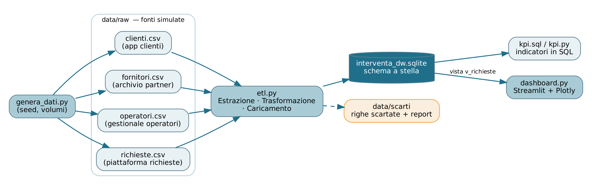
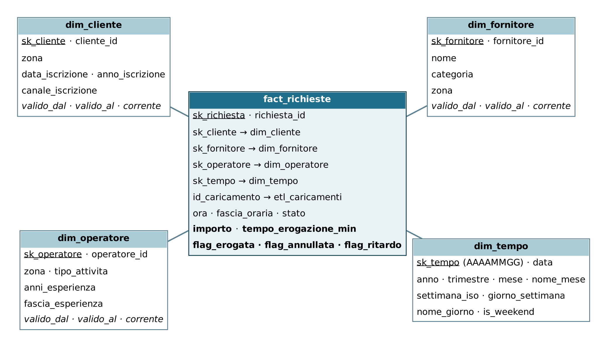
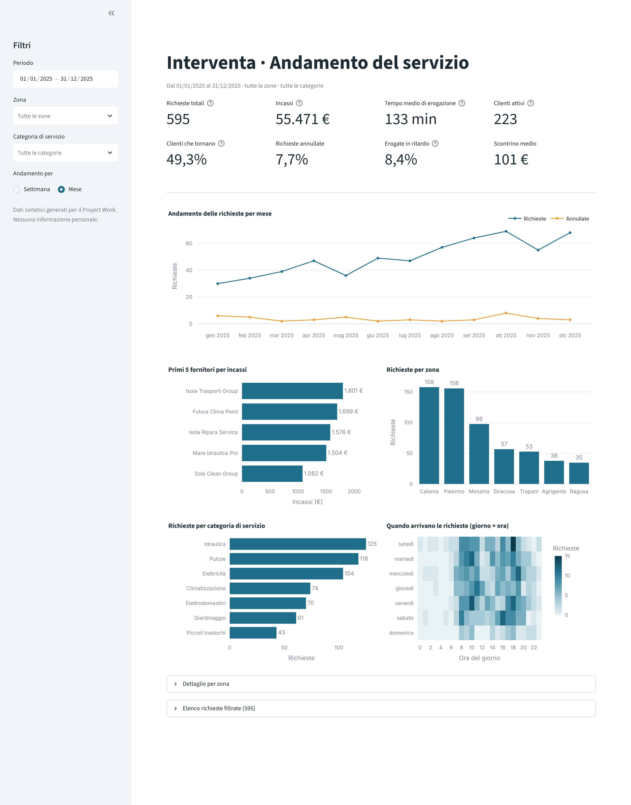
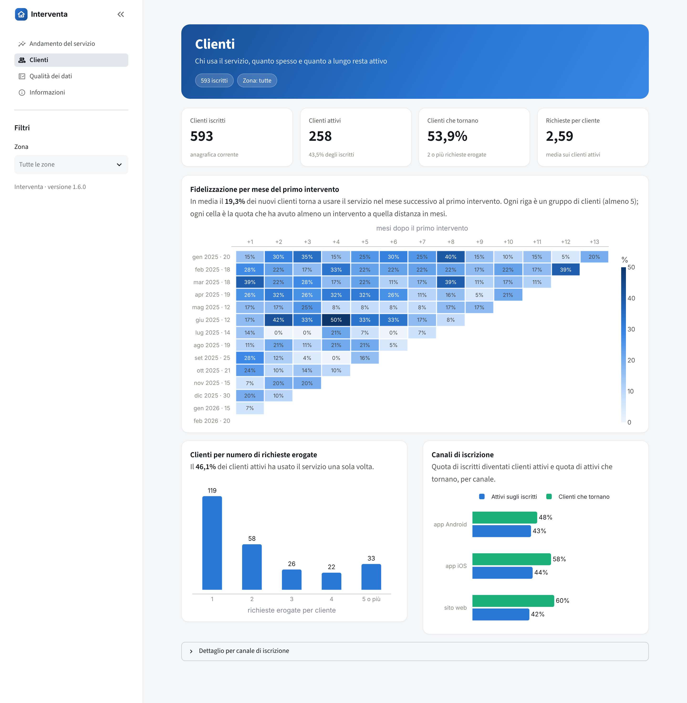
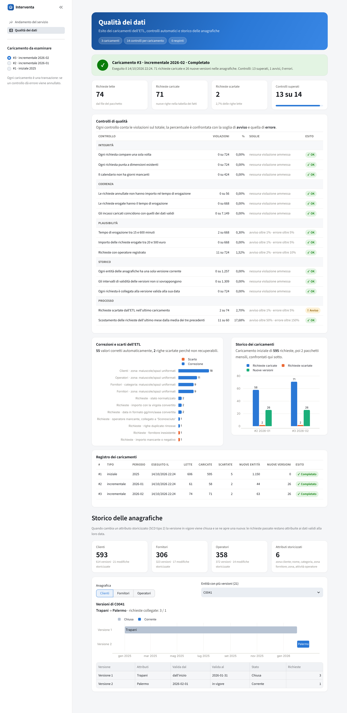

# Interventa

[](https://github.com/ChiccoHD/pw21-interventa/actions/workflows/test.yml)
[](https://pw21-interventa.streamlit.app)

Questo è il mio Project Work per il corso di laurea L-31 (Informatica per le aziende digitali, Università Pegaso),
traccia PW 21: progettare l'analisi dei dati per una startup digitale di servizi on-demand.

Interventa è una startup inventata: con un'app mette in contatto chi ha bisogno di un intervento in casa
(idraulico, elettricista, pulizie, ecc.) con delle ditte partner, in sette zone della Sicilia.
Ho generato dei dati finti, li ho caricati in un data warehouse e li ho messi in una dashboard.



## Dashboard online

La dashboard si può vedere qui: <https://pw21-interventa.streamlit.app>

Se non viene aperta da un po' può metterci qualche secondo a partire.

## Come avviarlo sul proprio PC

Serve Python 3.10 o più recente.

```bash
git clone https://github.com/ChiccoHD/pw21-interventa.git
cd pw21-interventa
python -m venv .venv
# Windows:  .venv\Scripts\Activate.ps1      Mac/Linux:  source .venv/bin/activate
pip install -r requirements.txt
python esegui_tutto.py
```

`esegui_tutto.py` fa tutto da solo: genera i dati, li carica nel database e apre la dashboard
su <http://localhost:8501>. Per chiuderla basta Ctrl+C nel terminale.

Su Windows, se PowerShell non fa attivare l'ambiente, va lanciato una volta
`Set-ExecutionPolicy -Scope CurrentUser RemoteSigned`.

Volendo si possono anche lanciare i passaggi uno per uno:

```bash
python -m src.genera_dati          # crea i dati finti
python -m src.etl                  # crea il database e carica il 2025
python -m src.etl --incrementale   # carica i mesi successivi
python -m src.kpi                  # stampa gli indicatori
python -m src.qualita              # fa i controlli sui dati
streamlit run app/dashboard.py     # apre la dashboard
python -m pytest                   # lancia i test
```

## I dati

I dati sono tutti finti e vengono creati dal programma. Si ottengono sempre gli stessi perché il generatore
usa un seme fisso (2). Di base ci sono 500 clienti, 300 fornitori, 350 operatori e 600 richieste del 2025,
più due "pacchetti" mensili (gennaio e febbraio 2026) che simulano l'arrivo di nuovi dati.

Una piccola parte dei dati è sporcata apposta (maiuscole sbagliate, importi con la virgola, date scritte in
modi diversi, righe doppie, ecc.) per far vedere come l'ETL li sistema.

Si possono cambiare alcuni parametri, ad esempio:
`python -m src.genera_dati --seed 7 --incrementi 4 --pulito`

Non ci sono dati personali: i clienti hanno solo un codice, la zona, la data e il canale di iscrizione.

## Come è fatto

```
src/      generazione dei dati, ETL, controlli di qualità e calcolo dei KPI
sql/      schema del database e query dei KPI
app/      dashboard (Streamlit)
tests/    test automatici
data/     dati di partenza, database e righe scartate
docs/     diagrammi e screenshot
```

Il database è in SQLite con uno schema a stella: al centro c'è la tabella delle richieste e intorno le tabelle
di clienti, fornitori, operatori e calendario.



Se un cliente cambia zona, o un fornitore cambia nome o sede, non si perde la versione vecchia: viene chiusa e
ne viene aperta una nuova (SCD di tipo 2). Così le richieste passate restano collegate a com'era il cliente in
quel momento. Per altri campi, come gli anni di esperienza di un operatore, si tiene solo il valore aggiornato
(SCD di tipo 1).

## ETL e controlli

L'ETL legge i CSV, sistema i dati sporchi e li carica nel database. Le righe che non si possono recuperare
(importi negativi, clienti o fornitori che non esistono) vengono scartate e salvate in `data/scarti/` con il motivo.

Il caricamento dei mesi nuovi è incrementale: carica solo quello che ancora non c'è, quindi rilanciarlo non
crea doppioni. Alla fine di ogni caricamento partono 14 controlli di qualità; se uno va in errore il caricamento
viene annullato e segnato come "RESPINTO".

## Indicatori

- **Richieste totali**: tutte le richieste valide, anche quelle annullate
- **Incassi**: somma degli importi delle richieste completate
- **Tempo medio**: minuti medi tra la richiesta e la fine dell'intervento
- **Clienti attivi**: clienti con almeno una richiesta completata
- **Clienti che tornano**: quota di clienti attivi con almeno due richieste
- **% annullate** e **% in ritardo**

Gli stessi indicatori sono calcolati sia in SQL che in Python, e un test controlla che vengano uguali.

## Dashboard

Ha quattro pagine:

- **Andamento del servizio**: indicatori, andamento mese per mese, fornitori, zone, categorie e orari,
  con filtri e download in CSV o Excel
- **Clienti**: quanti clienti tornano nei mesi dopo il primo intervento, quante richieste fanno e da quale
  canale si sono iscritti
- **Qualità dei dati**: esito dei caricamenti e dei controlli, dati scartati e storico delle anagrafiche
- **Informazioni**: spiegazione del progetto e definizioni







## Test

Con `python -m pytest` partono 26 test che controllano che i dati, il database, l'ETL e le pagine della
dashboard funzionino. Partono anche da soli su GitHub a ogni modifica (il badge in alto).

Le modifiche tra una versione e l'altra sono in [CHANGELOG.md](CHANGELOG.md).
